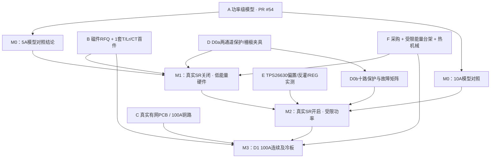

# 37 · D1 六线并行执行、任务依赖与三级硬件汇合（2026-11-07）

> **现行首件目标：48 V 标称、24:1 固定比例、约 2 V / 100 A、整机高度目标 ≤16 mm。** D2 的 120 A、D3 的 ≤10 mm 暂不进入 D1 第一台样机关键路径。**状态：EXECUTION_PLAN_ONLY / NOT_FOR_FAB**。本计划指导工作和证据移交，**不授权**任何带电试验、PCB 加工或 100 A 连续运行。

## 0. 从已有工作开始，不再重新开题

- [首件关键路径第34章](34_研发加速_首件最短关键路径_2026-11-05.md) 已明确 D0 两通道试验、磁件首件与真实有网 PCB 三线并行；本章**补齐任务编号、明确六条工作线和依赖**，不撤销第34章技术验收。
- [低电流 SR A/B 第36章](36_低电流SR开关双轨验证.md) 与 [PR #54](https://github.com/czy0126/CZY/pull/54) 将同一台 48V→约2V 的 D1 谐振电路按 0.4Ω、0.2Ω 负载及 SR ON/OFF 生成四份模型；**这是模型输入，不是 5A/10A 已输出的实测电流**。目前独立预检通过；不假设完整 Windows CI 或 LTspice 真正运行已通过。
- [PR #52](https://github.com/czy0126/CZY/pull/52) 提供 TPS26630RGET + 外部 Q1/Q2 的原生 KiCad 草案和准确料号；仅完成源级引脚校验，**物理封装、OEM 角落、原生 ERC、真实放电电路与 H1/H5 未闭合**。集中不修改尚未验证的完整主板。
- [PR #51](https://github.com/czy0126/CZY/pull/51) 指出旧 Q54+R57(47Ω/0.25W) 在持续 18V 反灌下行为模型约 6.315W，不能靠更改持续导通的同一电阻阻值实现原 1ms 放电与 0.25W 两个目标。**继续限制带 SR 实体运行；但不阻塞独立功率级模型研究**。
- [PR #53](https://github.com/czy0126/CZY/pull/53) 专门处理 SR Gerber 丝印内容与制造索引校验不一致；PR #52 的最新完整 CI 仍报告 5 项相关失败，**不可把修改哈希本身视为重新出图、制造验收或已合并**。
- 当前 `hardware/dcx_mech/routed_copper.json` 记录 61 个网络的**连通性草案**，其中 VOUT/PGND 为 0.8 mm 轨道，尚无覆铜且 `fabrication_approved=false`。**零未连线与 100 A 载流合格是两回事**。
- [Issue #1](https://github.com/czy0126/CZY/issues/1) DOT、[#9](https://github.com/czy0126/CZY/issues/9) 原生主板、[#12](https://github.com/czy0126/CZY/issues/12) 磁件与机械、[#36](https://github.com/czy0126/CZY/issues/36) 保护、[#6](https://github.com/czy0126/CZY/issues/6) 能量账本均按原任务保留，不复制关闭状态。

**可执行数据文件**（本章的任务唯一状态来源）：[29项并行执行表](../../hardware/dcx_main/d1_parallel_execution_2026-11-07.csv)、[五阶段验收门禁](../../hardware/dcx_main/d1_parallel_gate_matrix_2026-11-07.json)。任务表的 `owner_role` 是建议职能角色，不代表已经指派实际人员；`target_window` 是相对启动时间的**内部目标，不是采购、仿真或厂家承诺交期**。

## 1. 六条互不阻塞的工作线

| 线 | 现在直接开工，不能再等待什么 | 具体首份交付（有原始证据） | 负责人角色 | 关联 |
|---|---|---|---|---|
| **A 功率级模型** | 先跑 PR #54 的 5A SR_OFF/ON，再决定10A。无需等待磁件厂家、TPS26630、电流账本 | LTspice **本次** .log/.raw、deck/log SHA、Vout/I(Lr)/门极/体二极管诊断 | 仿真/数值工程 | PR #54；A01–A04 |
| **B 磁件** | 同时给至少两家询 ELP38/I38；ELP43/I43 作为备选，不等PCB完成 | RFQ发送证据、厂家DOT+真实端子、**先1只T+Lr+CT**，再测 L(I)/漏感/绝缘/高度 | 磁件/采购/台架 | Issues #1/#12；B01–B04 |
| **C 主板 PCB** | 现有61网草案立即转 100A 电流能力设计：四SR→Cout→JOUT、负回流、Kelvin、主桥；R8原生ECO并行，不等磁件全部定型 | 原生有网PCB、电流分布/铜箔/铜排预算、真实网表、最终GUI ERC/DRC | PCB/原生EDA | Issues #9/#12；C01–C05 |
| **D D0保护** | 独立低能量验证原边HO/LO及两种SR控制架构，二选一，再扩十路；不等100A主板 | 示波器VGS/FAULT/ACK/掉电数据、实际关断时间和完整故障矩阵 | 台架/保护电路 | Issue #36；D01–D06 |
| **E SR偏置** | TPS26630 OEM封装/测试与反灌感知放电架构独立展开，不占主功率级试验资源 | 完整15V偏置原生图、原厂模型角落与H1/H5波形，**不得照搬旧47Ω持续放电** | 电力电子/EDA/测试 | PR #51/#52；E01–E05 |
| **F 采购热机械** | 关键MPN采购与≤16mm含TIM冷板剖面并行；独立受限功率试验夹具无需等整板 | 采购/供货文件、样件、夹具限流校准记录、真实机械高度/接触热阻预算 | 采购/机械/热/台架 | Issues #4/#12；F01–F05 |

**真实瓶颈优先级：** 最先关心 A02 实跑模型、B01 真正发出询样、D01/D02 真实低能量波形、C02/C03 电流路径，而不是继续重复提交综述或输出没有动作的任务清单。**B01 必须有厂家发出记录才算完成；本仓库没有证据证明已真实发送。**

## 2. 哪些独立，哪些必须等待？

**立即可并行（不存在跨工作线前置依赖）**：A01/A02（PR #54 源文件就绪）、B01、C01、C02、D01、D02、E01、E03、F01、F02、F03。六个工作流可以分给不同职能，不用等某一项卡住其他五项。

**只有局部必须串行**：

- A01→A02→A03→A04。**M1只要求A02的5A模型结论，不强制等待A03的10A长仿真**；M2之前仍须收齐相关对照模型。
- B01→B02→B03→B04。磁件端子实际冻结要等厂家 B02；板框/铜路路径草案 C02 不需要等 B02。
- C02→C03；C04 要 B02 的真实物理脚图和 F01 实料号；最终 C05 要 C01/C03/C04 与 D04，但非制造原型布局不等完整。
- D02→D03→D04→D05；原边 D01 独立。**D06 实物全SR栅关断验证只依赖 D01+F03**，不必等完整十路 D0b 才能开始设计 M1 低能量台架。
- E01→E02，E03 可与 E01 同时开展；E04 要 E02+E03；E05 再基于 E04+D03 获取实物证据。**SR偏置解决不阻塞 A01–A04 模型计算。**
- F02/C03→F04，F03 完全可以现在做；F05 的真实到货会受供应商约束，但其等待不影响独立仿真与EDA。

**真正跨线合流**只发生在 M1/M2/M3 的安全和真实性判定，详见 JSON。任何模型测试通过都**不能**把硬件门禁 `ready` 改为 true。

## 3. 从现在起的短周期目标表

| 相对启动窗口 | A：仿真 | B：磁件 | C：主PCB | D：保护 | E：偏置 | F：采购/热 |
|---|---|---|---|---|---|---|
| **D0–D2** | 5A两模式真实仿真及日志 | 至少两家询样发出；明确端子/DOT字段 | R8原生检查+100A路径布局 | 原边两路/两种SR驱动独立低能量A/B | 核对TPS26630和隔离放电方向 | 优先下询单、设计限能夹具、16mm剖面 |
| **D3–D4** | 5A异常处理；10A模型与实际值对照 | 核查正式回图，决定先制一套磁件 | 主电流回路、关键MPN/Pad审查 | 决策A或B并启动D0b原生图 | 完成原生脚号/封装并跑OEM corner输入 | 输出采购清单、实际约束、公差 |
| **D5–D7+** | 模型结果形成M0诊断结论 | 收到样品则立即实测，无样品不得填通过 | 审查电流、网表、GUI ERC/DRC，仍须标注制造阻塞 | 如有样机完成故障矩阵并输出VGS | 真实H1/H5与16/18V反灌测试 | 100A铜排/层叠/冷板与接点热评估 |

**注意：D0/D2/D7 是建议的内部目标，不是已经排程成功的外部工作。** 如果少人承担多项，则资源优先投给 B01、A02、D01、C02 的第一份原始证据，剩余可推迟；不因某个外部供应商回复延迟就停止其他任务。

## 4. 汇合门禁——模型和实物分层，而非“全线完成后才启动”

| Gate | 准入条件（简要） | 可做什么 | **绝不代表** |
|---|---|---|---|
| **M0_5A** | A02真实 LTspice 5A SR_OFF/ON 日志、实际输出和故障极值 | 对谐振腔、整流路径做首轮诊断；决定 M1 夹具需求 | 不批准真实48V上电 |
| **M0_10A** | A03/A04 10A模拟和5A/10A对比 | 确定下一版 SR/负载与模型改进 | 不批准10A实物 |
| **M1** | M0_5A + B04真实磁件/绝缘 + D01真实原边关断 + D06实物SR关闭 + F03独立受限能量夹具；需工程人员签核 | 在受限能量条件下验证**真实SR关闭的低功率级** | 不允许未验关断、绝缘、整流二极管SOA的冒险通电 |
| **M2** | M1 + M0_10A + D05十路关断 + E05偏置/反灌/H1-H5 | 实测主动SR低电流换流、损耗、保护 | 不批准100A |
| **M3** | M2 + C05主板制造检查 + F04 100A铜路/冷却 + B04磁件实测 + 实际25/50/75/100A分级记录 | 讨论可持续D1额定与≤16mm样机验收 | 不能把一次短时100A、电路仿真或0DRC当成连续额定 |

真实状态在 [Gate JSON](../../hardware/dcx_main/d1_parallel_gate_matrix_2026-11-07.json) 中默认全部 `ready=false`。**M1 首次硬件尝试前必须有实物关断与安全试验方案，不能把PR #54的理想0V钳位复制成一条未经验证的实物开关。**

## 5. 抢时间的决策与必要止损

1. **不继续让 1ms VDD_SR 放电成为纯模型/体二极管SR_OFF仿真的门槛**，但 SR_ON 真实硬件前必须验证REG UVLO、真实 (V_{GS}) 关断和外源持续反灌安全；R57 反向长耗散问题仍是 P0。
2. **不强制 100A 能量账本 Issue #6 最后约0.09 W 残差闭合才能发磁件询样、画有网PCB或做低能量驱动测试**，但损耗、温升、磁储能最坏值仍需在最终定额和可发表分析中实证。
3. **不强制首样≤10 mm或120 A**。先按D1 16 mm 完成磁件端子和安装，其后以首样测得的最高实际热负荷决定薄型化、冷板与第二版。
4. **不要误认为48V/24=2.000V能保证100A 2.000V**。现有典型100A模型约1.89V；除非明确为带载严格2V±2%，否则把“约2V”写成工作包络并实测核对。如果严格2V是最终指标，须把母线/变比/后级调压改动作为单独设计评审，不得用优化铜损冒充自然满足。
5. **遇到重复两轮仍无进展的阻塞**：必须提出明确替代拓扑、交付测量或供应商方案；不在同一模型参数上无限扫步长，不把新版本审核文件计入可用样机进度。
6. **制造门禁是独立的**：当前61网的0.8mm VOUT/PGND连线只能说明连通；真实四线电阻、铜层/铜排过流、扩散热阻/引脚焊盘、PCB图纸和真正ERC/DRC全部另验。未建立全链证据，继续 `NOT_FOR_FAB`。

## 6. GitHub 与协作约定

**只把可审阅且互不覆盖的代码与工程内容并行合并**：

- **PR #54**（目标 `feat/d1-fab-package`）：5A/10A功率级模型独立线；独立预检通过。完整CI未获最终绿色结论前不宣称通过。
- **PR #53**（目标 `pr50-review`）：制造丝印一致性修复；须验证真实Gerber字节/网表和索引，不能靠哈希声称已经重新制作丝印。
- **PR #51**（目标 `pr50-review`，草稿）：旧偏置放电持续反灌安全门禁；不能将其诊断本身当作解决硬件放电。
- **PR #52**（目标 `fix/bias-cut-discharge-release-gate-20261107`，草稿）：TPS26630原生电路草案，先补实际封装/真实器件模型再并入硬件线；完整Windows CI检查时仍有SR制造字节错误。
- **本执行包**：建议直接基于 `feat/d1-fab-package` 提出独立文档 PR，先对齐路线图，避免与PR #51/#52产生文件冲突。

**维护规则**：将确实完成并有证据的新任务从 `PENDING_*` / `DRAFT_*` 更新到 `EVIDENCE_REVIEW`，只有真实原始资料经负责人复核才标 `VERIFIED`；同时附原始数据文件路径、报告或采购/供应商记录链接。不得因“跑过Python测试、生成CSV、收到口头同意”而冒充硬件通过。

总原则：**工程人员可以同时画板、仿真、订磁件、做保护台架、准备冷板；只有进入被测试设备实际带电、100A大电流或投板制造的那一刻，才需要相应真实安全证据汇合。**
